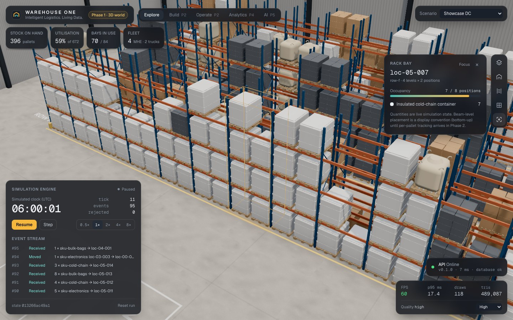
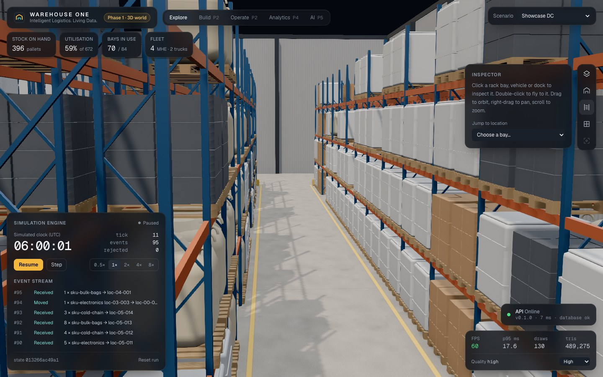
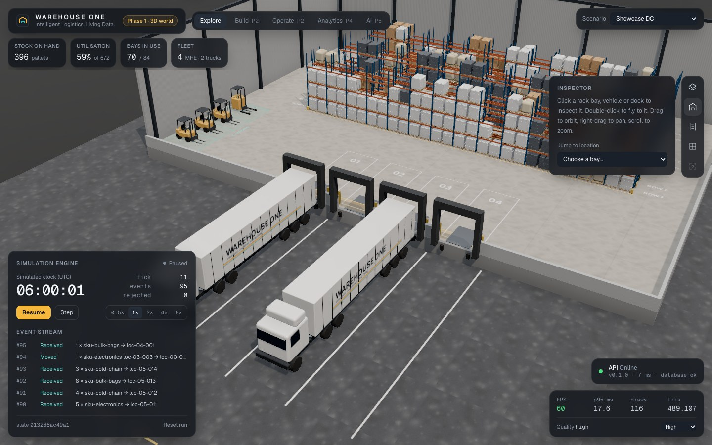
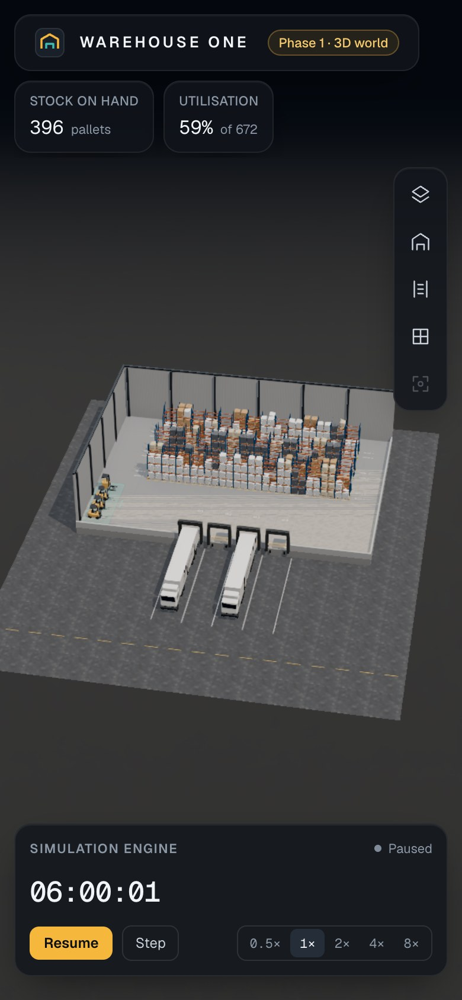

# WAREHOUSE ONE

**Intelligent Logistics. Living Data.**

A browser-based 3D warehouse digital twin built on a deterministic simulation engine, with a real
data engineering pipeline and AI-assisted optimisation planned on top. Every number on screen comes
from authoritative simulation state, and every state change is a typed, replayable domain event.

> **Project status: Phase 1 (Premium 3D world) is in review.** The facility, racks, stock and fleet
> are rendered from authoritative simulation state; vehicles are parked until Phase 2 gives them
> work. See [`docs/PROJECT_STATUS.md`](docs/PROJECT_STATUS.md) for what is verified and what is not.



| Aisle | Docks | Phone |
|---|---|---|
|  |  |  |

## What exists today

- **Deterministic simulation engine** (`packages/simulation`). Pure fixed-step `step()`, seeded
  RNG stored in state, typed commands with safe rejection, deterministic event IDs, versioned and
  integrity-checked snapshots, replay from a command log. A test suite covers the core invariants:
  determinism, replay equality, no negative stock, capacity, same-tick conflicts, unit
  conservation under a 3,000-tick randomised command stream, and pause freezing time.
- **Versioned event contract** (`packages/contracts`). Zod schemas published as JSON Schema
  (`data/schemas`) and mirrored in Pydantic, with drift tests on both sides and a golden
  deterministic run (`data/fixtures`) that Python reconciles against the engine's own totals.
- **3D digital twin** (`apps/web`). Next.js 16, React Three Fiber, Tailwind 4. A real-scale building
  with dollhouse cutaway, selective racking, pallets per SKU type, forklifts, reach truck,
  tractor-trailers at the docks, all procedural and instanced. Camera presets with responsive
  framing; selection and inspection of every bay, vehicle and dock; loading, error and empty
  states; adaptive quality tiers. 60 FPS with 1,000 pallets on an Apple M2 (measured,
  [details](docs/architecture/PERFORMANCE.md)).
- **Scenarios** (`packages/simulation`). Showcase, empty, and benchmark facilities with exactly
  100 / 300 / 1,000 pallets, all stocked through the normal command path.
- **API** (`apps/api`). FastAPI with structured JSON logs, request IDs, liveness/readiness/version
  endpoints, SQLAlchemy and Alembic on PostgreSQL 18, and a Dockerfile.
- **Quality gates.** ESLint/Prettier/tsc, Vitest, pytest (unit and integration), ruff, mypy
  `--strict`, Playwright e2e and a GitHub Actions CI with Docker Compose verification.

## Architecture

```text
commands ─► Simulation (pure, deterministic) ─► domain events ─► [Phase 3] outbox ─► Kafka ─► Parquet lake ─► dbt ─► analytics & AI
                 │ frozen state
                 ▼
     Zustand projection ─► React Three Fiber scene + HUD   (rendering is read-only)
```

Read more: [Architecture](docs/ARCHITECTURE.md) · [Event contract](docs/data/EVENT_CONTRACT.md) ·
[Decisions](docs/DECISIONS.md) · [Visual design spec](docs/design/VISUAL_DESIGN_SPEC.md) ·
[Performance](docs/architecture/PERFORMANCE.md) · [PRD](docs/product/PRD.md) · [Roadmap](docs/ROADMAP.md)

## Quick start

Requires Node 24, pnpm 11, Python 3.12 with [uv](https://docs.astral.sh/uv/), and Docker.

```bash
pnpm install && (cd apps/api && uv sync)
docker compose up -d --build --wait    # PostgreSQL + migrations + API on :8000
pnpm dev                               # http://localhost:3000
```

Controls: drag to orbit, scroll to zoom, right-drag to pan. Click a bay, vehicle or dock to inspect
it, or double-click to fly to it. Camera: `O` overview, `D` docks, `A` aisle, `T` plan, `F` focus
selection. Simulation: `Space` pause/resume, `.` step, `1`–`5` speed. `Esc` clears the selection.
URL options: `?scenario=showcase|empty|bench-100|bench-300|bench-1000` and `?quality=auto|high|medium|low`.
More detail, including port overrides, is in [docs/DEVELOPMENT.md](docs/DEVELOPMENT.md).

## Verification

```bash
pnpm check                      # format, lint, typecheck, unit tests, production build
pnpm test:e2e                   # browser tests against the production build
cd apps/api && uv run pytest && uv run pytest -m integration
pnpm bench:sim                  # simulation throughput
```

Measured Phase 0 results are recorded with their hardware context in
[docs/architecture/PERFORMANCE.md](docs/architecture/PERFORMANCE.md) and
[docs/phases/PHASE_0.md](docs/phases/PHASE_0.md).

## Roadmap

0 Foundation ✔ · 1 Premium 3D world (in review) · 2 Living simulation · 3 Data engineering (Kafka, MinIO/Parquet,
dbt, Airflow) · 4 Analytics · 5 AI logistics brain · 6 Digital twin scenarios · 7 Production release.

## Licence

Not yet chosen. All rights reserved until a licence is added.
