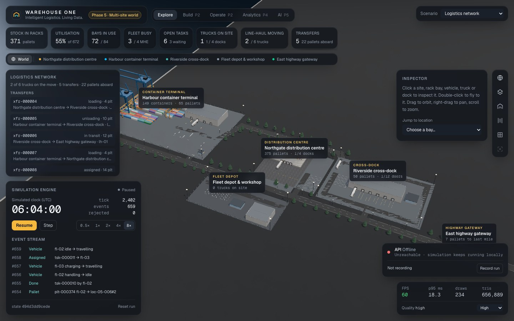
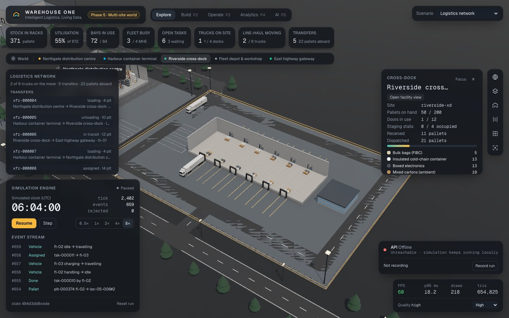
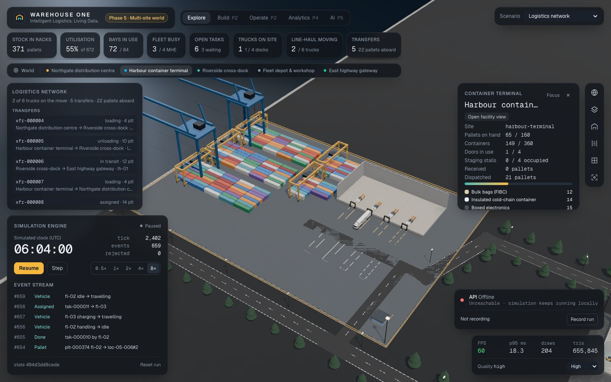
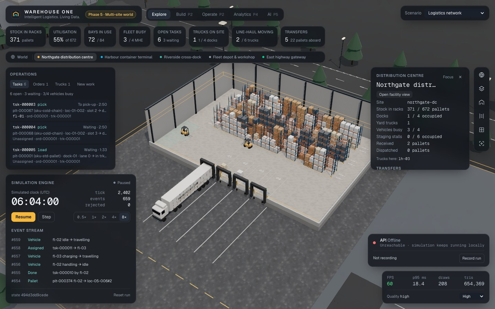

# WAREHOUSE ONE

**Intelligent Logistics. Living Data.**

A browser-based 3D warehouse digital twin built on a deterministic simulation engine, with a real
data engineering pipeline and AI-assisted optimisation planned on top. Every number on screen comes
from authoritative simulation state, and every state change is a typed, replayable domain event.

> **Project status: Phases 0–3 are merged into `main` (Phase 3: real data engineering, PR #5).
> Phase 5, the multi-site logistics world, is in review on `feature/p5-multi-site-world`.** See
> [`docs/PROJECT_STATUS.md`](docs/PROJECT_STATUS.md) for what is verified and what is not.



| Cross-dock | Container terminal | Distribution centre |
|---|---|---|
|  |  |  |

| Aisle | Docks | Phone |
|---|---|---|
|  |  |  |

## What exists today

- **Deterministic simulation engine** (`packages/simulation`). Pure fixed-step `step()`, seeded
  RNG stored in state, typed commands with safe rejection, deterministic event IDs, versioned and
  integrity-checked snapshots, replay from a command log. A test suite covers the core invariants:
  determinism, replay equality, no negative stock, capacity, same-tick conflicts, unit
  conservation under a 3,000-tick randomised command stream, and pause freezing time.
- **Versioned event contract** (`packages/contracts`). Zod schemas published as JSON Schema
  (`data/schemas`) and mirrored in Pydantic, with drift tests on both sides and a golden
  deterministic run (`data/fixtures`) that Python reconciles against the engine's own totals.
- **3D digital twin** (`apps/web`). Next.js 16, React Three Fiber, Tailwind 4. A real-scale building
  with dollhouse cutaway, selective racking, pallets per SKU type, forklifts, reach truck,
  tractor-trailers at the docks, all procedural and instanced. Camera presets with responsive
  framing; selection and inspection of every bay, vehicle and dock; loading, error and empty
  states; adaptive quality tiers. 60 FPS with 1,000 pallets on an Apple M2 (measured,
  [details](docs/architecture/PERFORMANCE.md)).
- **Scenarios** (`packages/simulation`). Showcase, empty, and benchmark facilities with exactly
  100 / 300 / 1,000 pallets, all stocked through the normal command path.
- **Living operations** (Phase 2). Pallets with exact positions, routed forklifts and reach trucks,
  tasks, orders, inbound and outbound trucks at docks, all drawn live from simulation state, with an
  operator panel whose commands go through the engine's command path.
- **Multi-site logistics world** (Phase 5, on its branch). The DC inside a logistics park: a
  container terminal (vessel calls, devanning), a cross-dock, a fleet depot with a workshop and a
  highway gateway, joined by roads. Six line-haul trucks drive deterministic inter-site transfers
  (seeded lanes or operator requests), reserve doors and stalls, and hand over to the DC's own
  dock and yard simulation. World and facility views, site and truck inspectors.
- **Event store and data platform** (Phase 3). Runs recorded from the browser or
  headless go into PostgreSQL in one transaction per batch (append-only event log + transactional
  outbox). From there:
  - an outbox relay publishes them to Kafka (KRaft);
  - idempotent consumers write a deduplicated ledger and raw Parquet bronze on MinIO, with a DLQ;
  - dbt (DuckDB) builds silver and gold back into the lake;
  - Airflow runs refresh, backfill and a reconciliation that fails on any mismatch.

  A smoke test proves the whole path, including outages, replays and an injected discrepancy.
- **API** (`apps/api`). FastAPI: ingestion endpoints (`/api/v1/simulations`), structured JSON logs,
  request IDs, liveness/readiness/version, SQLAlchemy and Alembic on PostgreSQL 18.
- **Quality gates.** ESLint/Prettier/tsc, Vitest, pytest (unit and integration), ruff, mypy
  `--strict`, Playwright e2e and a GitHub Actions CI with Docker Compose verification.

## Architecture

```text
commands ─► Simulation (pure, deterministic) ─► domain events ─► API ─► PostgreSQL event log + outbox
                 │ frozen state                                                   │
                 ▼                                                   relay ─► Kafka ─► ledger · Parquet bronze (MinIO)
     Zustand projection ─► 3D scene + HUD (read-only)                              │
                                                     dbt silver/gold ◄─────────────┘   Airflow: refresh · backfill · reconcile
```

Read more: [Architecture](docs/ARCHITECTURE.md) · [Event contract](docs/data/EVENT_CONTRACT.md) ·
[Decisions](docs/DECISIONS.md) · [Visual design spec](docs/design/VISUAL_DESIGN_SPEC.md) ·
[Performance](docs/architecture/PERFORMANCE.md) · [PRD](docs/product/PRD.md) · [Roadmap](docs/ROADMAP.md)

## Quick start

Requires Node 24, pnpm 11, Python 3.12 with [uv](https://docs.astral.sh/uv/), and Docker.

```bash
pnpm install && (cd apps/api && uv sync)
docker compose up -d --build --wait    # PostgreSQL + migrations + API on :8000
pnpm dev                               # http://localhost:3000
```

The Phase 3 data platform is an opt-in Compose profile (Kafka, MinIO, relay, consumers, Airflow;
about 2 GB of memory):

```bash
docker compose --profile data up -d --build --wait
pnpm sim:record --api http://localhost:8000 --scenario showcase --ticks 3000
scripts/data-platform-smoke.sh         # end-to-end proof; exits non-zero on any failed check
```

Controls: drag to orbit, scroll to zoom, right-drag to pan. Click a bay, vehicle or dock to inspect
it, or double-click to fly to it. Camera: `O` overview, `D` docks, `A` aisle, `T` plan, `F` focus
selection. Simulation: `Space` pause/resume, `.` step, `1`–`5` speed. `Esc` clears the selection.
URL options: `?scenario=showcase|empty|bench-100|bench-300|bench-1000` and `?quality=auto|high|medium|low`.
More detail, including port overrides, is in [docs/DEVELOPMENT.md](docs/DEVELOPMENT.md).

## Verification

```bash
pnpm check                      # format, lint, typecheck, unit tests, production build
pnpm test:e2e                   # browser tests against the production build
cd apps/api && uv sync --all-extras && uv run pytest && uv run pytest -m "integration and not kafka"
pnpm bench:sim                  # simulation throughput
```

Measured Phase 0 results are recorded with their hardware context in
[docs/architecture/PERFORMANCE.md](docs/architecture/PERFORMANCE.md) and
[docs/phases/PHASE_0.md](docs/phases/PHASE_0.md).

## Roadmap

0 Foundation ✔ · 1 Premium 3D world ✔ · 2 Living simulation ✔ · 3 Data engineering (in development) ·
4 Analytics · 5 AI logistics brain · 6 Digital twin scenarios · 7 Production release.

## Licence

Not yet chosen. All rights reserved until a licence is added.
